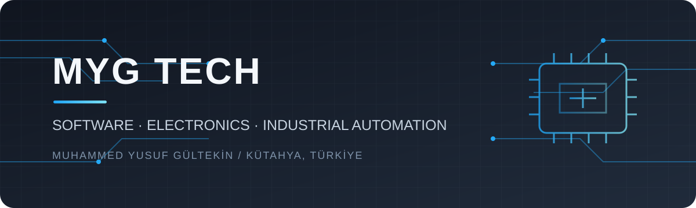

<!-- MYG TECH | GitHub Profile -->

  
  

    
    
    
  

## Hi, I'm Muhammed Yusuf Gültekin

I'm a developer working across software, electronics and industrial automation. I enjoy building practical systems at the intersection of hardware and software — from desktop engineering tools to embedded devices, PLC-based automation and computer vision.

## Featured projects

| Project | Description | Technologies |
|---|---|---|
| [MYG Electrical](https://github.com/nicewo/MYG.Electrical) | Desktop engineering software for electrical schematics and automated wiring workflows | C#, WPF, .NET |
| [MyG RideR](https://github.com/nicewo/MyGRideR) | Motorcycle app featuring GPS tracking, a speedometer and GPX export | .NET MAUI, GPS |
| [RealVisionLab](https://github.com/nicewo/RealVisionLab) | Computer vision and image-processing experiments | Computer Vision |
| [MyG JARVIS](https://github.com/nicewo/MyG.JARVIS) | Personal assistant and automation-focused software project | Software |
| [MalzemeTalep](https://github.com/nicewo/MalzemeTalep) | Desktop application for material request and tracking workflows | C#, WPF |

## Technical areas

**Software development**
 

**Embedded systems & electronics**
 

**Industrial automation & engineering**
 

## How I work

- **End-to-end development:** Bringing electronics, firmware, communication and application software together.
- **Field-oriented engineering:** Designing for reliability, maintainability and real operating conditions.
- **Continuous improvement:** Learning, prototyping and turning ideas into working products.

   
  **Explore my projects and work**
   
  <a href="https://myusufgultekin.web.app/">myusufgultekin.web.app</a>
    
  MYG TECH · Software & Electronics Engineering

