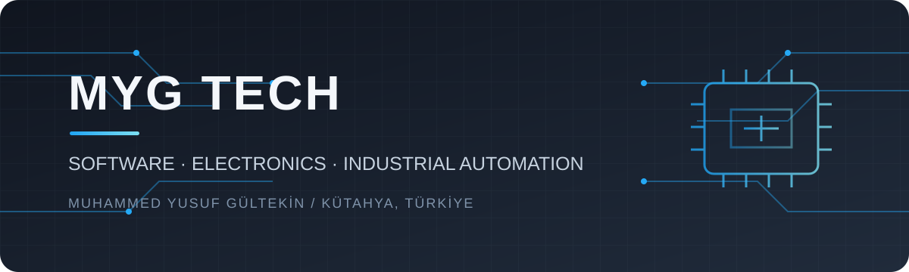

<!-- MYG TECH | GitHub Profile -->

  
  

    
    
    
  

## Merhaba, ben Muhammed Yusuf Gültekin

Yazılım, elektronik ve endüstriyel otomasyon alanlarında çalışan bir mühendislik geliştiricisiyim. Donanım ile yazılımın kesiştiği noktalarda; sahada karşılığı olan, gerçek problemlere çözüm üreten sistemler geliştirmeyi seviyorum.

Çalışmalarım; masaüstü yazılımlarından gömülü sistemlere, PLC tabanlı otomasyondan bilgisayarlı görü uygulamalarına kadar uzanıyor.

## Öne çıkan projeler

| Proje | Açıklama | Teknolojiler |
|---|---|---|
| [MYG Electrical](https://github.com/nicewo/MYG.Electrical) | Elektrik şeması çizimi ve otomatik bağlantı odaklı masaüstü mühendislik yazılımı | C#, WPF, .NET |
| [MyG RideR](https://github.com/nicewo/MyGRideR) | GPS takibi, hız göstergesi ve GPX dışa aktarımı özelliklerine sahip motosiklet uygulaması | .NET MAUI, GPS |
| [RealVisionLab](https://github.com/nicewo/RealVisionLab) | Bilgisayarlı görü ve görüntü işleme çalışmaları | Computer Vision |
| [MyG JARVIS](https://github.com/nicewo/MyG.JARVIS) | Kişisel asistan ve otomasyon odaklı yazılım projesi | Software |
| [MalzemeTalep](https://github.com/nicewo/MalzemeTalep) | Malzeme talep ve takip süreçleri için masaüstü uygulaması | C#, WPF |

## Teknik alanlar

**Yazılım geliştirme**
 

**Gömülü sistemler ve elektronik**
 

**Endüstriyel otomasyon ve mühendislik**
 

## Yaklaşımım

- **Uçtan uca geliştirme:** Elektronik donanım, firmware, haberleşme ve uygulama yazılımını birlikte ele almak.
- **Saha odaklı mühendislik:** Güvenilirlik, bakım kolaylığı ve gerçek çalışma koşullarını tasarımın parçası yapmak.
- **Sürekli geliştirme:** Öğrenmek, prototiplemek ve fikirleri çalışan ürünlere dönüştürmek.

   
  **Projelerimi ve çalışmalarımı incelemek için**
   
  <a href="https://myusufgultekin.web.app/">myusufgultekin.web.app</a>
    
  MYG TECH · Software & Electronics Engineering

